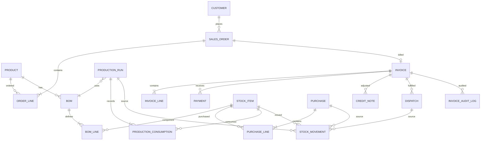

# Order-to-Audit System — Design Note

**Project:** Order-to-Audit System for a Small Food Manufacturer  
**Stack:** Django, PostgreSQL, Django Admin and responsive web views

## 1. Architecture and logical data model

The system connects sales and production through a common, traceable inventory ledger. Sales orders flow through verification, invoicing, dispatch and payment. Purchases and production runs record material receipts and consumption, while good production adds finished goods. Reports use these recorded transactions rather than manually overwritten stock figures.

This is a **logical business-entity diagram**; related Django records are grouped by purpose.

**Key controls:** each stock movement is traceable to its source transaction. Invoice lines preserve issued billing details; payments link to invoices; credit notes adjust issued invoices without deleting their history. Role permissions separate salesman, factory admin, production, accountant/auditor and owner. Invoice issue/cancellation events and production-run activity have audit history.

## 2. Stock and BOM computation

For each item:

\[
\text{Closing}=\text{Opening}+\text{Receipts}-\text{Issues}\pm\text{Adjustments}
\]

One Murukku 200 g batch has an expected yield of 200 packets. Its BOM is 40 kg flour, 10 L oil, 1.2 kg spice mix, 200 pouches and 10 cartons. Planned quantities scale with batch count; the supervisor records actual use, good output and wastage.

\[
\text{Consumption variance \%}=
\frac{\text{Actual}-\text{Planned}}{\text{Planned}}\times100
\qquad
\text{Yield variance \%}=
\frac{\text{Good}-\text{Expected}}{\text{Expected}}\times100
\]

The benchmark produced 188 good packets from 200 expected (**−6% yield**). Oil was 10.5 L versus 10 L (**+5%**); flour and spice matched plan. Pouch consumption was 194 (188 good + 6 damaged), 6 below the 200 planned; carton use was 9 versus 10.

| Item | Benchmark calculation | Closing |
|---|---:|---:|
| Flour | 100 + 60 purchase − 40 issue | **120 kg** |
| Oil | 30 − 10.5 issue | **19.5 L** |
| Spice | 5 − 1.2 issue | **3.8 kg** |
| Pouches | 500 − 188 good − 6 damaged | **306** |
| Cartons | 30 − 9 used | **21** |
| Finished goods | 50 + 188 − 150 dispatched | **88 packets** |

Finished goods are 238 packets immediately after production and 88 after Retailer A's dispatch. The subsequent 120-packet Distributor B order therefore has a **32-packet shortage**.

## 3. Costing and valuation

The application uses **weighted-average material valuation**. After buying 60 kg flour at ₹45/kg, the average flour rate is:

\[
\frac{(100\times₹42)+(60\times₹45)}{160}=₹43.125/\text{kg}
\]

| Cost component | Calculation | Cost |
|---|---:|---:|
| Flour | 40 kg × ₹43.125 | ₹1,725 |
| Oil | 10.5 L × ₹140 | ₹1,470 |
| Spice | 1.2 kg × ₹200 | ₹240 |
| Pouches | 194 × ₹2.50 | ₹485 |
| Cartons | 9 × ₹15 | ₹135 |
| **Materials and packaging** |  | **₹4,055** |
| Labour and power/gas | ₹1,200 + ₹600 | **₹1,800** |
| **Total run cost** |  | **₹5,855** |

The labour and power/gas amounts are allocated directly to this single run. Cost per saleable packet is:

\[
₹5,855 \div 188 = \mathbf{₹31.14}\text{ approximately}
\]

The denominator is good output, so the unit cost reflects actual yield and wastage. For a multi-product operation, overheads would need a documented allocation driver.

## 4. Billing assumption

Retailer A's 150 packets × ₹50 gives taxable value ₹7,500. At the exercise's assumed 5% intra-state GST, CGST is ₹187.50 and SGST is ₹187.50; invoice total is **₹7,875**. After a ₹4,000 payment, outstanding is **₹3,875**.

The GST rate and tax identifiers are benchmark/demo inputs. Generated invoices are demonstration documents, not statutory tax invoices or evidence of GST-system integration. Monetary calculations use decimal arithmetic.
